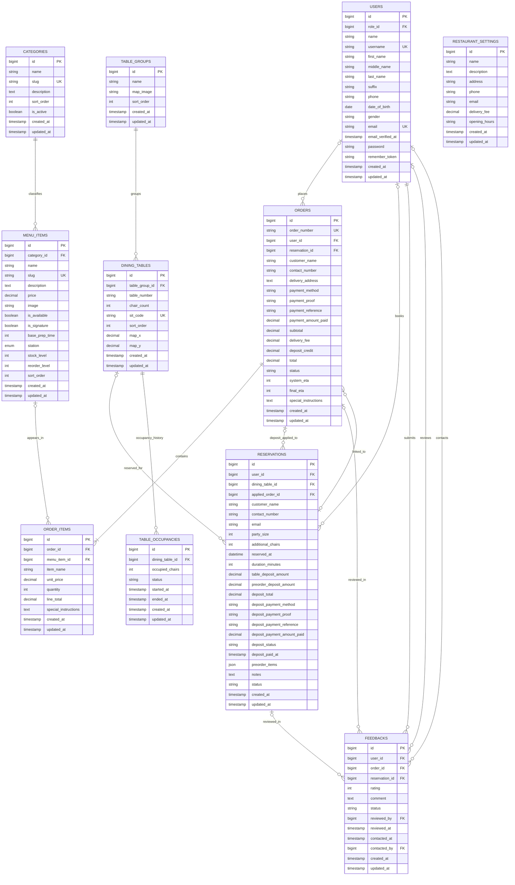
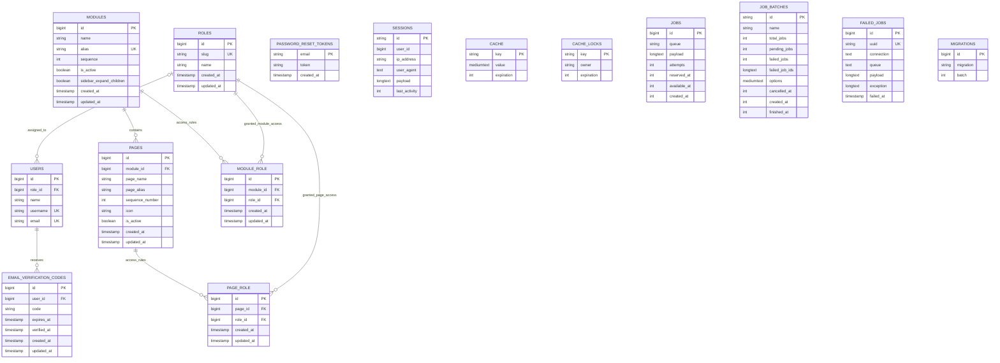

# Smoke 'n' Grill Database ERD

This ERD documents the schema defined by the project's Laravel migrations. It
includes restaurant operations, access control, and Laravel support tables.
Fields marked `PK` are primary keys; fields marked `FK` are foreign keys or
relationship keys.

## Restaurant operations

`RESERVATIONS.applied_order_id` and `ORDERS.reservation_id` are separate
nullable references. `TABLE_OCCUPANCIES` stores occupancy history; an active
occupancy is selected by application logic. `RESERVATIONS.preorder_items` is
JSON data, not a separate relational table. `RESTAURANT_SETTINGS` is currently
independent of the other tables.

## Access control and Laravel support

The `module_role` and `page_role` tables are many-to-many pivots. Their
`role_id` (and `page_role.page_id`) columns are indexed and used as Eloquent
relationships, but the migrations do not declare database foreign-key
constraints for those columns. `users.role_id` and `sessions.user_id` are also
modeled by the application without a database foreign-key constraint.
Password-reset tokens are keyed by email and are not directly related to the
`users` table by a foreign key. Cache, queue, failed-job, and migration tables
are Laravel infrastructure tables.
